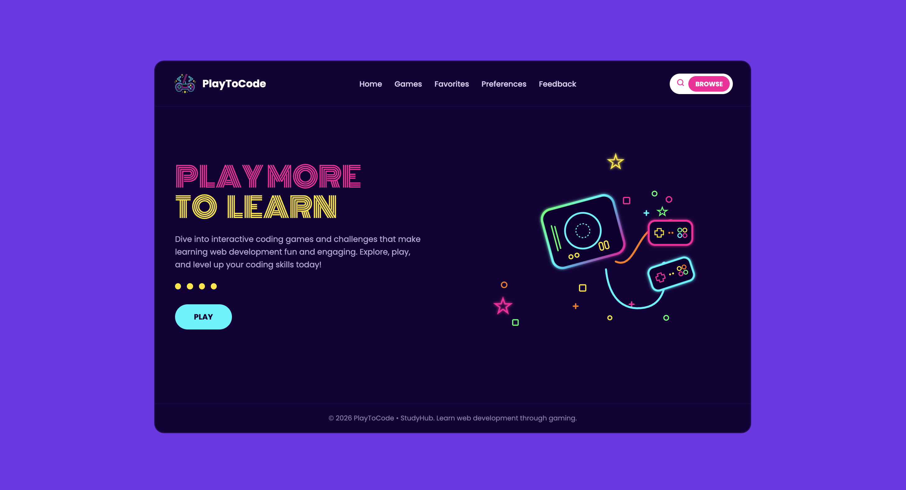
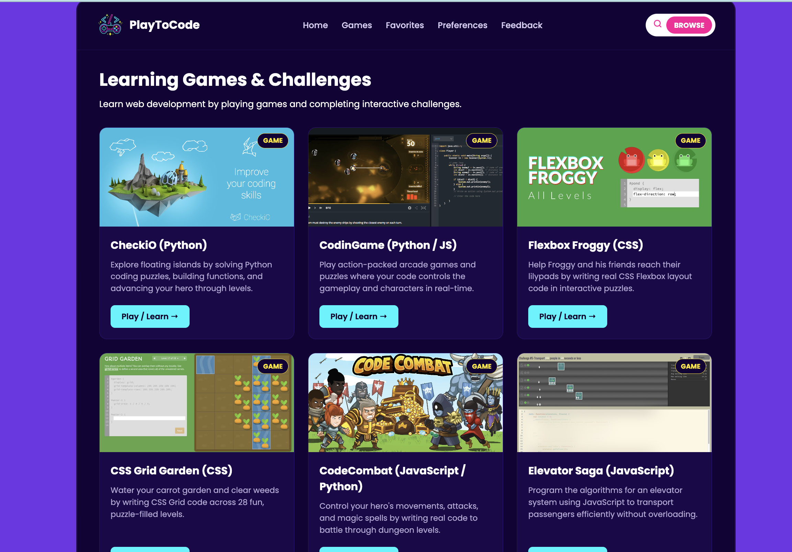
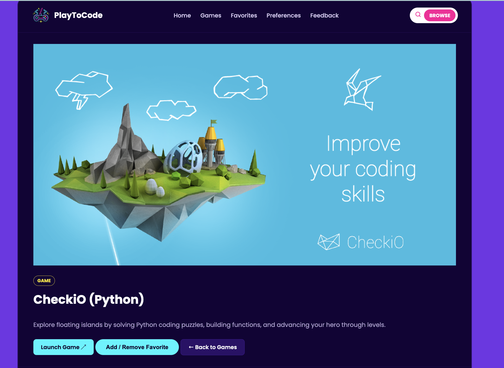
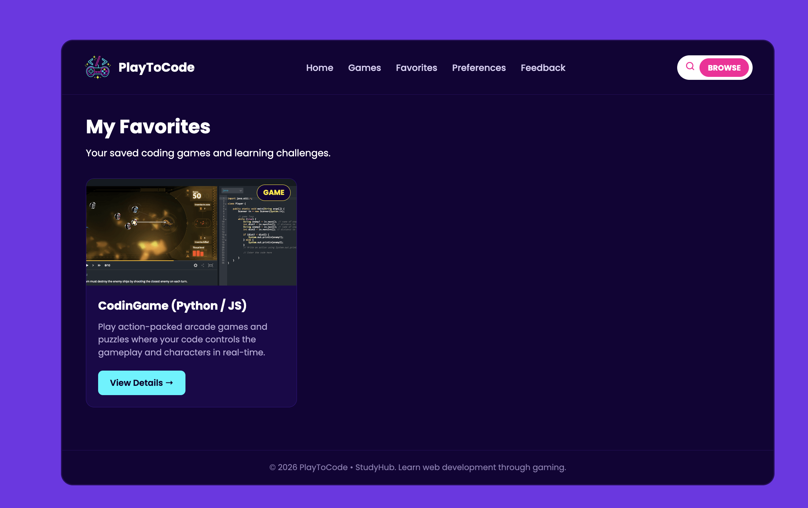
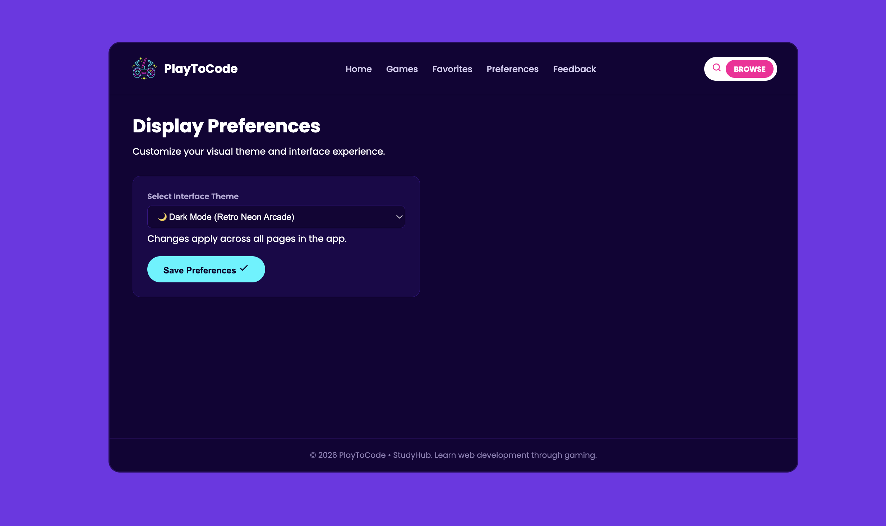
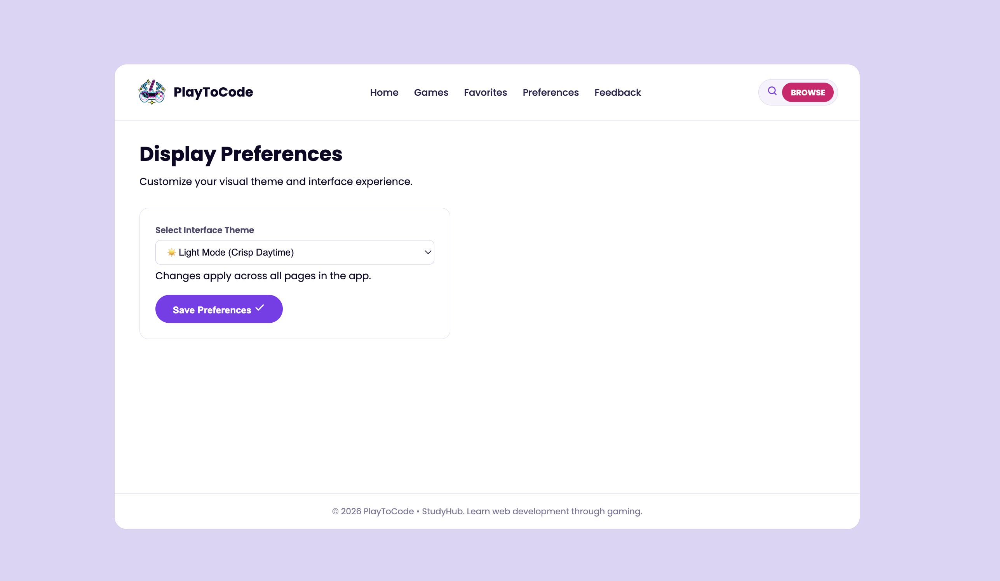
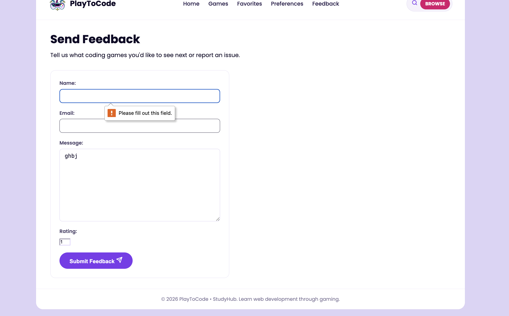
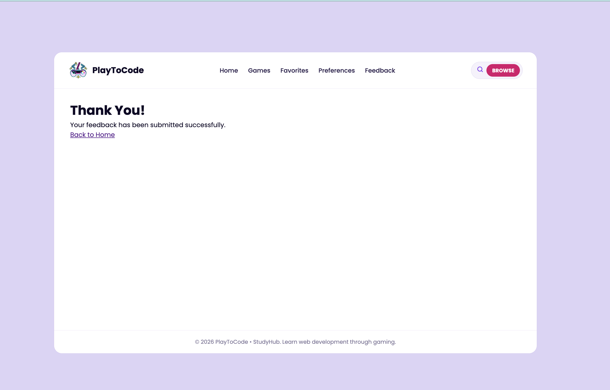

# StudyHub 🎮

StudyHub is a Django web application designed to make learning **Python, Django, HTML, CSS, and JavaScript** more interactive through educational games and learning resources.

The website allows users to browse games, view game details, save their favorite games, customize their preferences, and submit feedback.

---

## 📸 Screenshots

### Home Page — Dark Mode



### Games List



### Game Details



### Favorites



### Preferences — Dark Mode



### Preferences — Light Mode



### Feedback Form Validation



### Thank You Page



---

## ✨ Features

* Browse educational games and learning resources.
* View detailed information about each game.
* Add and remove games from favorites.
* Store favorites using Django sessions.
* Customize website preferences.
* Light and dark theme support.
* Submit feedback through a Django form.
* Form validation with error messages.
* Custom 404 error page for invalid resources.
* Responsive interface.
* Navigation between pages using Django URL names.

---

# 📁 Project Structure

```text
studyhub_project/
│
├── manage.py
│
├── studyhub_project/
│   ├── __init__.py
│   ├── settings.py
│   ├── urls.py
│   ├── asgi.py
│   └── wsgi.py
│
├── core/
│   ├── __init__.py
│   ├── urls.py
│   ├── views.py
│   ├── forms.py
│   └── ...
│
├── templates/
│   ├── base.html
│   └── core/
│       ├── home.html
│       ├── games.html
│       ├── game_detail.html
│       ├── favorites.html
│       ├── preferences.html
│       ├── feedback.html
│       ├── thank_you.html
│       └── 404.html
│
└── static/
    ├── css/
    │   └── style.css
    │
    └── images/
        └── ...
```

---

# 🔗 URLs and Views

The application uses Django URL patterns to connect pages to their corresponding views.

| URL                       | View              | Purpose                                 |
| ------------------------- | ----------------- | --------------------------------------- |
| `/`                       | `home`            | Displays the home page                  |
| `/games/`                 | `games`           | Displays available games                |
| `/games/<id>/`            | `game_detail`     | Displays details for a specific game    |
| `/favorites/`             | `favorites`       | Displays the user's favorite games      |
| `/favorites/add/<id>/`    | `add_favorite`    | Adds a game to favorites                |
| `/favorites/remove/<id>/` | `remove_favorite` | Removes a game from favorites           |
| `/preferences/`           | `preferences`     | Displays and updates user preferences   |
| `/feedback/`              | `feedback`        | Displays the feedback form              |
| `/thank-you/`             | `thank_you`       | Displays the feedback confirmation page |

Internal links use Django's `` template tag instead of hardcoded URLs.

---

# 🧩 Templates

The project uses Django templates to generate the website pages.

### `base.html`

Contains the shared layout used across the website, including:

* Navigation bar
* Main page structure
* Theme preferences
* Footer
* Common CSS and static files

Other templates extend the base template to avoid repeating the same HTML.

### Main Templates

* **`home.html`** — Landing page and introduction.
* **`games.html`** — Displays the list of educational games.
* **`game_detail.html`** — Displays information about an individual game.
* **`favorites.html`** — Displays games saved by the user.
* **`preferences.html`** — Allows the user to change website preferences.
* **`feedback.html`** — Contains the feedback form and validation messages.
* **`thank_you.html`** — Confirmation page after submitting feedback.
* **`404.html`** — Custom page displayed when a requested resource does not exist.

---

# 🎨 Static Files

Static files are stored inside the `static/` directory.

```text
static/
├── css/
│   └── style.css
│
└── images/
    └── ...
```

CSS is used to control:

* Layout
* Colors
* Typography
* Cards
* Navigation
* Light and dark themes
* Responsive design
* Form styling

Images are used for the educational games and other visual elements.

Django's static file system is used to load these resources in the templates.

---

# 🍪 Cookies

Cookies are used to store user preferences in the browser.

For example, the website can store the selected theme so that the user's preferred appearance can be maintained between page visits.

The project does not require users to create an account to use the main features.

---

# 🔐 Sessions

Django sessions are used to store temporary user-specific information.

One example is the **Favorites** feature.

When a user adds a game to favorites, its ID can be stored in the session:

```python
request.session["favorites"]
```

This allows the user to maintain a favorites list without requiring a database model.

Sessions are also useful for maintaining information while navigating between different pages.

---

# 📝 Forms

The project uses Django Forms to handle user feedback.

The feedback form is responsible for:

* Collecting user information.
* Validating submitted data.
* Displaying validation errors.
* Preventing invalid submissions.
* Redirecting the user to the thank-you page after successful submission.

Example validation flow:

```text
User submits form
       ↓
Django validates the form
       ↓
 ┌───────────────┐
 │ Is it valid?  │
 └───────────────┘
    ↓          ↓
   Yes         No
    ↓          ↓
Thank You   Show Errors
```

Validation errors are displayed near the relevant form fields to help the user correct their input.

---

# ⚠️ Known Limitations

* Game and resource information is currently stored in Python data structures rather than a database.
* Favorites are stored using sessions and are not permanently associated with a user account.
* There is no authentication or user registration system.
* Feedback is not currently stored permanently in a database.
* The interface can be improved further for a more polished user experience.
* The number of games and learning resources is currently limited by the manually defined data.
* Some features are implemented for demonstration and learning purposes rather than production use.

---

# 🚀 Future Improvements

Possible future improvements include:

* Improve the overall interface and user experience.
* Add more educational games and learning resources.
* Add a database using Django models.
* Store games and resources in the database instead of Python lists.
* Store user feedback in the database.
* Add user authentication and personal accounts.
* Connect favorites to individual user accounts.
* Add more advanced game functionality.
* Add search and filtering for games and resources.
* Improve responsive design for different screen sizes.

---

# 🛠️ Technologies Used

* **Python**
* **Django**
* **HTML**
* **CSS**
* **Django Templates**
* **Cookies**
* **Django Sessions**
* **Django Forms**

---

# 🎯 Project Goal

The main goal of StudyHub is to demonstrate how Django can be used to build an interactive educational website while practicing important Django concepts such as:

* URL routing
* Views
* Templates
* Static files
* Forms
* Form validation
* Cookies
* Sessions
* Template inheritance
* Error handling
* Custom 404 pages

The project focuses on learning web development through a simple and interactive **game-based learning experience**.
# mada-alwuthainani-unit4
